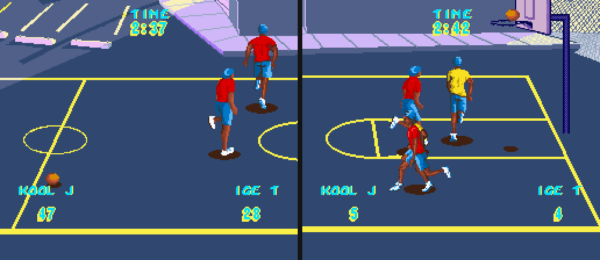
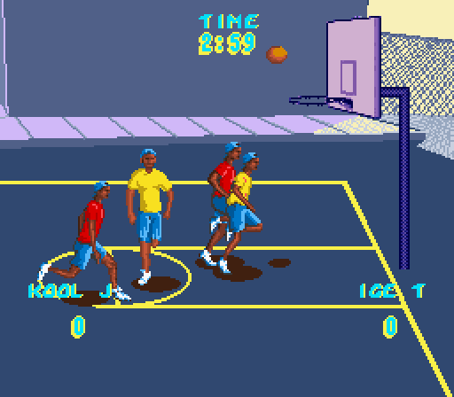
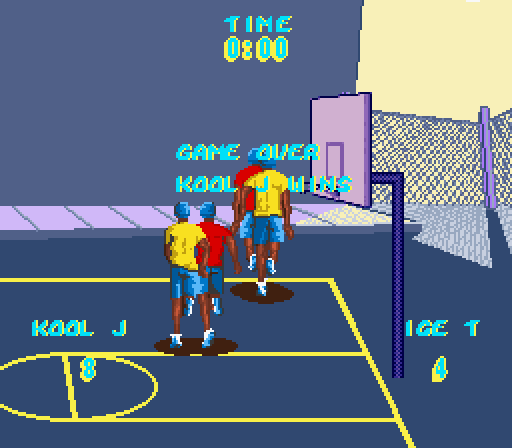

# Rap Basketball (SNES Prototype) – Playable Patch


<sub>Left: the original 1994 prototype. Right: with this patch.</sub>

**Rap Basketball** was a cancelled Super Nintendo game starring Ice-T and LL Cool J (named "ICE T" and "KOOL J" in the game). The only surviving build is an early alpha. You can run around a half court and dribble, but you can't shoot or score, the clock never moves, and the opponents stand frozen in place.

I reverse-engineered the prototype and wrote the game logic it never got. With this patch it's actually a playable game of 2-on-2 street ball against the CPU or a friend.

If you enjoy it, you can support me on Ko-fi ☕ **[ko-fi.com/StewYork91](https://ko-fi.com/StewYork91)**

---

## What the patch adds

| | Original prototype | Patched |
|---|---|---|
| Shooting | ❌ none | **B** shoots a real arc at the rim |
| Scoring | ❌ fake "47 – 28" painted on the HUD | Live scores, 2 pts or **3 pts** from long range |
| Game clock | ❌ frozen at 2:37 | Counts down from **3:00**, then "GAME OVER" and the winner |
| Opponent | ❌ frozen (it's actually player 2 with no controller) | **CPU-controlled Ice T** who chases loose balls, plays defense, steals and shoots |
| Steals | ❌ | **Y** near the ball handler |
| Possession | – | Missed shots rebound off the rim. After a basket the other team checks the ball at the top of the key |
| Passing (A) | Launches the ball even if you don't have it | Only works when you're holding the ball |
| Teams | Everyone wears red | Ice T's team wears **yellow** |

Shot odds depend on how far away you are, from about 85% under the rim down to about 35% from deep.

### Controls

| Button | Action |
|---|---|
| D-pad | Move |
| X (hold) | Run |
| B | Shoot (while holding the ball) |
| Y | Steal attempt |
| A | Throw/pass in the direction you're facing |
| Start | Back to the Bonsai logo, which restarts the game |
| Select | Hidden animation viewer (see below) |

**2 players:** press anything on controller 2 and Ice T switches from CPU to human control.

 

---

## How to play it

You need your own copy of the prototype ROM. This repo does **not** include any ROMs. You can check you have the right file with these hashes:

| | |
|---|---|
| File | `Rap Basketball (USA) (Proto).sfc` (1,048,576 bytes, no header) |
| CRC32 | `3F0343A7` |
| MD5 | `5c58b54bf19ffee86f5b6d53aacee255` |
| SHA-1 | `c19109d5187a716d0543b5cd59033c225defb6b4` |

**Easiest way:** apply [`patch/Rap Basketball (Proto) - Playable.ips`](patch/) with any IPS patcher, like [Rom Patcher JS](https://www.marcrobledo.com/RomPatcher.js/) in your browser or [Floating IPS](https://github.com/Alcaro/Flips). Then play it in any SNES emulator (bsnes, Mesen, Snes9x, …).

**Or build it from source** (Python 3, no extra packages needed):

```bash
python tools/build.py "Rap Basketball (USA) (Proto).sfc"
```

This assembles `src/patch.asm`, writes `Rap Basketball (USA) (Proto) [Playable].sfc`, and regenerates the IPS. A copier-headered ROM (with the extra 512 bytes) is handled automatically.

---

## History of the game

Rap Basketball was developed in **mid-to-late 1994** by **Bonsai Entertainment Corporation**. That was a tiny team: programmer **Joseph "Holy Joe Rock & Roll" Moses**, artist **Charles Moses**, and another artist based in Tahoe. Bonsai's logo is still the first thing you see when the ROM boots.

Bonsai was contracted by **E-Ware**, a company in Tahoe, California. E-Ware claimed to have a deal with **Motown's games division** covering Ice-T and LL Cool J. The plan was a half-court 2-on-2 game with famous rappers, at a time when celebrity sports games were booming.

The deal fell apart before the game got past alpha. According to Moses, the E-Ware contact never paid the team and then vanished. In his words: "We never got paid." Without money, Bonsai stopped working on it. What survived is an early demo with:

- the half-court, with its detailed city backgrounds and hoop
- player movement, running and dribbling
- a sound driver and a music track
- nothing else: no shooting, no scoring, no AI

Motown did go on to release a rap basketball game, **Rap Jam: Volume One** (1995), but it's a completely separate game made by a different developer. Nothing from Bonsai's prototype carried over.

Years later Joseph Moses shared the prototype ROM, and **SNES Central** documented it, which is how it ended up preserved online. Until now it's mostly been a curiosity you boot up for 30 seconds.

Sources: [SNES Central – Rap Basketball](https://snescentral.com/article.php?id=0137) (including the interview with Joseph Moses) and [Unseen64](https://www.unseen64.net/2008/04/14/rap-basketball-snes-unreleased/).

---

## Hidden stuff I found in the prototype

While taking the code apart I found several things nobody seems to have documented:

- **2-player mode works.** The "frozen opponent" everyone mentions isn't broken. It's player 2's character, read from controller 2. Plug in a second pad on the original ROM and Ice T moves, his AI teammate follows him, and both players can grab and dribble.
- **A hidden animation viewer.** Press **Select** and your player switches into a debug mode. Holding A or B steps through all 35 animation frames, and Y flips the sprite. Press Select again to go back.
- **Pause is coded but switched off.** The main loop has a working Start-to-pause toggle, but a flag set at startup (`$09C4 = $8000`) disables it.
- **The scores and clock were never real.** "KOOL J 47 / ICE T 28 / TIME 2:37" are part of the compressed background tilemap. No code ever touches them.
- **38 sound hooks.** There's a whole table of play-sound / play-music stubs (IDs `$00`–`$25`), but only a couple are ever used, probably the dribble bounce.
- **An unused object type.** One of the object descriptors (`$91:F06A`) has empty init/update routines, likely a planned hoop or net object.
- **The "TOYS" library.** The ROM header's internal title is `TOYS` and the ROM contains a "TOYS Code Version 2.6" message: "THIS IS NOT A PRODUCTION ROM … FAST ROM REQUIRED!" This seems to be Bonsai's in-house SNES framework.

The full technical write-up is in **[docs/NOTES.md](docs/NOTES.md)**: memory map, object system, ball physics, coordinate system and every hook the patch uses.

---

## How I made it

There was no source code, so everything was rebuilt from the ROM:

1. **Disassembly.** I wrote a small 65816 disassembler (`tools/dis65816.py`) and traced the code from the reset vector.
2. **A headless SNES emulator.** I wrote `tools/emu.py` (65816 CPU, DMA, a faked sound chip) and `tools/ppu.py`, a renderer for screenshots. That let me run the prototype in a script, see which code actually executes, and find the dead code.
3. **Mapping the game.** I worked out the object table, controller handling, ball physics, the court's coordinate system and where the rim sits in world space.
4. **Writing the missing game.** I wrote about 1.7 KB of new 65816 assembly (`src/patch.asm`) in empty ROM space, assembled with my own tiny assembler (`tools/asm65816.py`). It hooks into the original engine in four places.
5. **Testing.** A bot (`tools/bot.py`) plays full games against the CPU in the emulator to check shooting, steals, scoring, game over and restart.

Want to hack on it yourself? Everything's in `src/patch.asm`, and `tools/build.py` rebuilds the ROM.

> **Note:** I tested this a lot in my own emulator, which is simplified compared to real hardware. If you see any glitch in bsnes, Mesen, Snes9x or on a real console (flickering score digits, a wrong palette, etc.), please open an issue with your emulator name and version.

---

## Repo layout

```
patch/   IPS patch (apply this to your own ROM)
src/     patch.asm – all new game code and the hooks
tools/   build.py, asm65816.py, dis65816.py, emu.py, ppu.py, bot.py
docs/    NOTES.md (technical notes) + screenshots
```

`emu.py`, `ppu.py` and `bot.py` need `numpy` and `Pillow` for rendering. Everything else uses only the standard library.

---

## Legal

This project contains **only original code and a patch file**. No copyrighted ROM data is distributed. Rap Basketball, the Bonsai Entertainment logo and all game assets belong to their respective owners. Ice-T and LL Cool J are referenced only because the prototype uses their likenesses/names. This is a non-commercial fan preservation project.

My code (the patch, assembler, disassembler, emulator and tools) is released under the [MIT License](LICENSE).

---

Made by **Saitken91**. If this brought a dead game back to life for you, buy me a coffee at **[ko-fi.com/StewYork91](https://ko-fi.com/StewYork91)** ☕🏀
